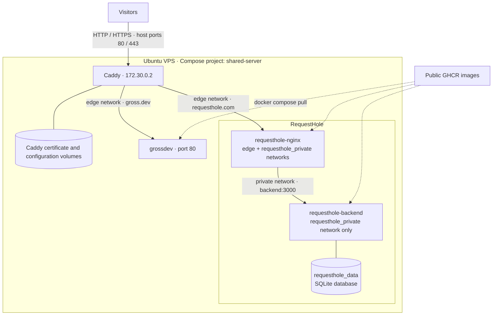

# My Shared Server

This private repository runs multiple websites and applications on one Ubuntu VPS. Docker Compose manages them as a single project, `shared-server`. Caddy routes requests by domain and manages HTTPS certificates.

Applications run from public GitHub Container Registry (GHCR) images. This repository contains their production configuration; application source code and image builds stay outside it.

## Architecture



Caddy is the only container that publishes host ports. Public-facing application services share the `edge` network (`172.30.0.0/24`) and can communicate with one another; this network does not isolate applications.

RequestHole also has an internal network, `requesthole_private` (`172.31.255.0/24`). Its backend has no direct connection to `edge` or the internet.

Caddy's fixed address is part of RequestHole's client-IP trust configuration: nginx trusts forwarding headers from `172.30.0.2`, and the backend trusts its nginx frontend at `172.31.255.2`.

| Location                       | Purpose                                                            |
| ------------------------------ | ------------------------------------------------------------------ |
| `bootstrap.sh`                 | Install Docker Engine and Compose; prepare server directories      |
| `compose.yml`                  | Define Caddy, shared resources, and application includes           |
| `Caddyfile`                    | Configure domains, reverse proxies, and redirects                  |
| `.env`                         | Select application image tags; contains no secrets                 |
| `apps/<application>/`          | Store each application's Compose file and supporting configuration |
| `.github/workflows/format.yml` | Check repository formatting                                        |

## Set up a new server

### 1. Check prerequisites

These instructions assume:

- A newly provisioned VPS running a [Docker-supported Ubuntu release](https://docs.docker.com/engine/install/ubuntu/#os-requirements).
- Working SSH key access as a regular user with sudo privileges.
- Access to this private GitHub repository and the hosted domains' DNS settings.
- Published application images compatible with the server's CPU architecture.

Run server commands as that regular SSH user. The deployment directory is `/srv/server`.

> [!CAUTION]
> This procedure recreates the current applications with empty volumes on a new host. RequestHole data is disposable, and no application-data backup or restore process is configured. Before adding an application whose state must survive host loss, define and test its backup and restore procedure.

Allow inbound traffic through the VPS provider's firewall and any host firewall:

| Protocol | Port                     | Purpose                                   |
| -------- | ------------------------ | ----------------------------------------- |
| TCP      | Your configured SSH port | Administration                            |
| TCP      | 80                       | HTTP redirects and certificate validation |
| TCP      | 443                      | HTTPS                                     |

Preserve SSH access when changing firewall rules. Docker-published ports can bypass UFW rules, so application services must not publish additional host ports. See [Docker's firewall guidance](https://docs.docker.com/engine/install/ubuntu/#firewall-limitations).

### 2. Give the server read-only GitHub access

Install the tools needed to clone the repository:

```bash
sudo apt-get update
sudo apt-get install -y git openssh-client
```

Create a dedicated deployment key:

```bash
mkdir -p ~/.ssh
chmod 700 ~/.ssh

ssh-keygen -t ed25519 \
  -f ~/.ssh/github-server-deploy \
  -C "shared-server-deploy"

cat ~/.ssh/github-server-deploy.pub
```

In `GrossNate/my-shared-server`, open **Settings → Deploy keys → Add deploy key**. Paste the public key and leave **Allow write access** unchecked.

Add this entry to `~/.ssh/config`, preserving any existing entries:

```sshconfig
Host github-server
    HostName github.com
    User git
    IdentityFile ~/.ssh/github-server-deploy
    IdentitiesOnly yes
```

Set permissions:

```bash
chmod 600 ~/.ssh/config
chmod 600 ~/.ssh/github-server-deploy
```

Test access:

```bash
ssh -T github-server
```

Before accepting GitHub's host key, compare its fingerprint with [GitHub's published fingerprints](https://docs.github.com/en/authentication/keeping-your-account-and-data-secure/githubs-ssh-key-fingerprints).

A successful test reports authentication followed by “GitHub does not provide shell access.” Its exit status of 1 is expected. If you protected the deployment key with a passphrase, Git operations may prompt for it.

The private key stays on the server. Only its `.pub` counterpart belongs in GitHub. See [GitHub's deploy-key documentation](https://docs.github.com/en/authentication/connecting-to-github-with-ssh/managing-deploy-keys#deploy-keys).

### 3. Clone and bootstrap

Create the deployment directory and clone the repository:

```bash
sudo install -d \
  -o "$USER" \
  -g "$(id -gn)" \
  -m 0755 \
  /srv/server

git clone \
  git@github-server:GrossNate/my-shared-server.git \
  /srv/server

cd /srv/server
./bootstrap.sh
```

The script installs Docker Engine and Compose from Docker's official apt repository, enables Docker at boot, and adds your user to the `docker` group. It does not configure SSH, firewall rules, or DNS.

The script's final message mentions 1Password, but no secrets manager is required for the current applications.

Log out and reconnect so the group change takes effect. Then verify:

```bash
cd /srv/server

docker version
docker compose version
docker ps
```

Membership in the `docker` group grants privileges equivalent to root. Limit it to trusted users.

### 4. Review image versions and download images

The root `.env` currently selects:

```dotenv
REQUESTHOLE_VERSION=latest
GROSSDEV_VERSION=latest
```

Prefer an existing release or commit tag from each GHCR package so the selected revision is recorded in Git. Preserve the exact published spelling, including any `sha-` prefix. Both RequestHole images must have the selected tag.

These variables select tags, not digests: the application Compose files construct image references as `repository:tag`. Tags can be republished, and `latest` changes as new images are published.

Validate and pull:

```bash
cd /srv/server

docker compose config --quiet
docker compose config --images
docker compose pull
```

Run these commands in order and stop if any fails. `config --quiet` produces no output on success; `config --images` shows the selected image references.

Public GHCR images require no registry login. The deployment key grants access to this private repository, not to private container images.

### 5. Configure DNS and start the applications

Create or update these records using the new VPS's public IPv4 address:

| Hostname              | Record | Target                  |
| --------------------- | ------ | ----------------------- |
| `requesthole.com`     | A      | VPS public IPv4 address |
| `www.requesthole.com` | CNAME  | `requesthole.com`       |
| `gross.dev`           | A      | VPS public IPv4 address |
| `www.gross.dev`       | CNAME  | `gross.dev`             |

Remove conflicting records for these hostnames. Keep an AAAA record only if IPv6 reaches this server and its published ports. Preserve unrelated records, such as mail configuration.

Start the project:

```bash
cd /srv/server

docker compose up -d --wait
docker compose ps
```

Compose creates the networks and volumes. Do not create the `edge` network manually.

`--wait` waits for services with health checks to become healthy and other services to be running. It does not verify public routing or application functionality. A failed startup or health check does not automatically roll back the deployment.

Once DNS and inbound connectivity work, [Caddy obtains and renews HTTPS certificates](https://caddyserver.com/docs/automatic-https) using Let's Encrypt. Certificate issuance may take time after DNS changes.

### 6. Verify the deployment

Check both sites, their `www` redirects, and HTTP-to-HTTPS redirects:

```bash
curl -I https://requesthole.com
curl -I https://www.requesthole.com
curl -I https://gross.dev
curl -I https://www.gross.dev
curl -I http://requesthole.com
curl -I http://gross.dev
```

Open both sites in a browser. For RequestHole, create a hole, submit a request, and confirm that it appears.

Inspect failures with:

```bash
docker compose logs --tail=100 caddy
docker compose logs --tail=100 requesthole-nginx requesthole-backend
docker compose logs --tail=100 grossdev
```

For certificate failures, check DNS and inbound ports. For HTTP 502 responses, check the upstream service's health, network membership, and listening port.

When replacing a host, allow DNS changes to propagate and verify traffic reaches the new host before retiring the old one. Remove the old host's GitHub deploy key afterward. This procedure does not guarantee a migration without downtime.

## Add a site or application

Make configuration changes in a local checkout, commit and push them, then pull them onto the server. Always deploy from the root project in `/srv/server`.

### 1. Inspect the application image

Read the image's deployment documentation and identify:

- Its public GHCR image reference, published tag, and supported CPU architectures.
- Its internal listening port and required environment variables.
- Supporting services, storage requirements, and startup dependencies.
- A suitable health check using tools present in the image.

The web process must listen on an interface reachable from other containers, usually `0.0.0.0`, rather than only `127.0.0.1`.

Docker networks are deployment configuration, not properties imposed by an image. Adapt any upstream Compose examples to this project's service and network names.

### 2. Create its application configuration

Create `apps/<application>/compose.yml` and place supporting files beside it.

The following is a template for a single-container application. Replace `example`, `OWNER/IMAGE`, and `EXAMPLE_VERSION` with application-specific names:

```yaml
services:
  example:
    image: "ghcr.io/OWNER/IMAGE:${EXAMPLE_VERSION:?Set EXAMPLE_VERSION in the root .env}"
    restart: unless-stopped

    networks:
      - edge
```

Add its version variable to the root `.env`, using a published image tag. Add required environment variables, storage mounts, and a health check to the service.

Follow these conventions:

- Use unique service, network, and volume keys across the project.
- Connect the public-facing service to `edge`; omit host `ports:` mappings.
- Declare `edge` only in the root `compose.yml`. Application files reference it.
- Put backends and databases on application-specific networks. Use `internal: true` only when services on that network do not require outbound connectivity.
- Use service names for discovery. Preserve aliases required by an application's internal configuration.
- Mount persistent data in named volumes. Relative bind-mount paths resolve from the included application's directory.
- Keep application-specific settings under `apps/`, except image tags in `.env` and domain routing in `Caddyfile`.

Use `apps/grossdev/compose.yml` as a single-container example. `apps/requesthole/compose.yml` demonstrates multiple services, health-based startup ordering, private networking, and storage.

Ordinary service discovery does not need fixed IPs. If an app requires trusted-proxy addresses, configure its actual proxy chain and avoid conflicting subnets or addresses.

### 3. Include it in the root project

Add the new file to the root `compose.yml`:

```yaml
include:
  - ./apps/requesthole/compose.yml
  - ./apps/grossdev/compose.yml
  - ./apps/example/compose.yml
```

Preserve the existing services, networks, and volumes. Included applications belong to `shared-server`; do not launch their Compose files as separate projects.

See Docker's [include](https://docs.docker.com/reference/compose-file/include/) and [networking](https://docs.docker.com/compose/how-tos/networking/) documentation.

### 4. Configure its domain

Add site blocks to the root `Caddyfile`. Replace the example domain, service name, and port:

```caddyfile
example.com {
	reverse_proxy example:8080
}

www.example.com {
	redir https://example.com{uri} permanent
}
```

Use the container's internal listening port. Create the domain's DNS records using the pattern in the server setup instructions.

### 5. Check and deploy

Run locally before committing:

```bash
npm ci
npm run format
npm run check:format
docker compose config --quiet
```

Formatting uses Node.js/npm, shfmt 3.14.1, and Docker. The scripts use the pinned Prettier dependency and a Caddy formatter container. GitHub Actions checks the same formatting; these development tools are not required on the VPS.

After committing and pushing, run on the server. Replace `example` with the new application's service name:

```bash
cd /srv/server

git pull --ff-only
docker compose config --quiet
docker compose pull example
docker compose up -d --wait example
```

Stop if a command fails. For a multi-service application, name all its services in the pull and startup commands. Compose may also start declared dependencies.

After the application is ready, apply the updated routes:

```bash
docker compose exec -T caddy \
  caddy reload --config - --adapter caddyfile < Caddyfile
```

This sends the current host file directly to Caddy, avoiding stale contents if Git or an editor replaced the bind-mounted file. Caddy applies the configuration without restarting; a rejected configuration leaves the active configuration running. See [Caddy reload](https://caddyserver.com/docs/command-line#caddy-reload).

Verify the domain, redirects, application behavior, and container health:

```bash
docker compose ps
docker compose logs --tail=100 example
```

### Update or roll back an application

Change its tag in `.env`, commit and push, then fetch the configuration on the server:

```bash
cd /srv/server

git pull --ff-only
docker compose config --quiet
```

For gross.dev:

```bash
docker compose pull grossdev
docker compose up -d --wait grossdev
```

For RequestHole:

```bash
docker compose pull requesthole-backend requesthole-nginx
docker compose up -d --wait requesthole-backend requesthole-nginx
```

Check `docker compose ps`, logs, and the application after deployment. Downloads leave running containers in place; recreating containers can briefly interrupt the affected application.

Targeted deployments leave unrelated applications running when shared infrastructure is unchanged. This setup does not provide rolling deployments with zero downtime.

For routing-only changes, pull the updated `Caddyfile` and use the reload command above. Changes to shared networks or Caddy's container configuration require separate maintenance planning.

To roll back, select a previously published tag and repeat the deployment. Reverting an image does not reverse database migrations.

> [!CAUTION]
> Do not use `docker compose down` for routine deployments: it stops the whole project. Adding `-v` can also delete persistent volumes. Normal updates use targeted `pull` and `up` commands and preserve named-volume data.
